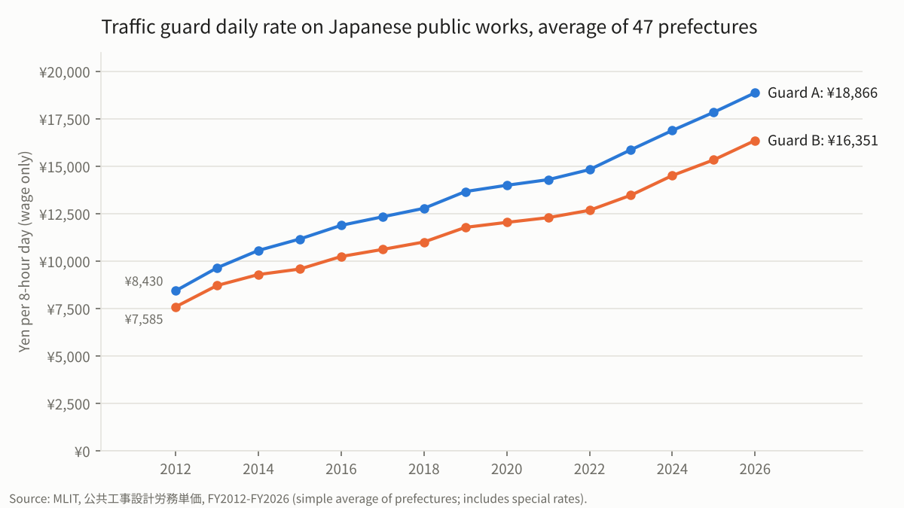
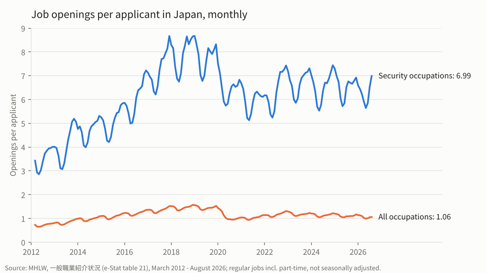

# japan-guard-price-panel

Japan's official daily pay rates for traffic guards on public works, for all 47 prefectures, every year from FY2012 to FY2026, alongside how many job openings there are for each security job seeker.

Every year Japan's Ministry of Land, Infrastructure, Transport and Tourism (MLIT) sets the *public works design labor rates* (公共工事設計労務単価): the daily wage that government cost estimates assume for each construction trade in each prefecture. Two of the trades are traffic guards working for private security companies:

- **Guard A** (交通誘導警備員A): a security company guard doing traffic guarding who has passed the national grade 1 or grade 2 traffic-guarding exam.
- **Guard B** (交通誘導警備員B): any other security company guard directing traffic.

This repo turns the ministry's yearly PDF tables into one clean table, and adds the Ministry of Health, Labour and Welfare's monthly job-openings figures for security occupations.





**Status:** data built and checked.

## The data

### Guard rates: `data/clean/guard_rates_by_prefecture.csv`

 has 1,410 rows: 15 table years x 47 prefectures x 2 grades.

| Column | Meaning |
|---|---|
| `table_year` | The year the table is published for (FY2012-FY2026) |
| `effective_from` | Month the rates took effect (YYYY-MM) |
| `pref_code`, `prefecture_ja`, `prefecture_en` | Prefecture (standard codes 01-47) |
| `grade` | A or B |
| `daily_rate_yen` | Rate in yen for a regular 8-hour working day |
| `special_rate` | `yes` if the source marks the figure as a special rate (see below) |
| `note` | What the special rate is |
| `source_file`, `source_page` | Where the figure is in `data/raw/mlit/` |

### Job openings: `data/clean/security_jobs_monthly.csv`

Monthly national figures, March 2012 to August 2026, from MHLW's job placement statistics (一般職業紹介状況), for **security occupations** (保安の職業 / 保安職業従事者) and, as a benchmark, **all occupations**. Measures: new openings, active openings, new applicants, active applicants, and active openings per applicant (有効求人倍率). Regular jobs including part-time, not seasonally adjusted.

| Column | Meaning |
|---|---|
| `month` | YYYY-MM |
| `classification` | Occupation classification the figure is published under (see below) |
| `occupation`, `occupation_ja`, `occupation_en` | `security` or `all` |
| `measure` | `new_openings`, `active_openings`, `new_applicants`, `active_applicants`, `active_openings_ratio` |
| `value` | Number of people/openings, or the ratio |
| `source_file`, `source_sheet` | Where the figure is in `data/raw/mhlw/` |

- These figures count only jobs and job seekers registered at Hello Work, Japan's public employment offices, not the whole labor market.
- **Security occupations are broader than traffic guards.** MHLW does not publish a guard-only series in these tables, so this is the closest available measure.
- **Two classifications.** Up to March 2023 MHLW used its own occupation classification (4th revision); from April 2023 it uses the Japan Standard Occupational Classification, recalculated back to April 2022. For security occupations the two give identical figures in the 12 months they overlap (April 2022-March 2023), so the series can be joined; both versions are kept in the file.
- National only: these tables do not break occupations down by prefecture.

## What the guard rates are, and are not

- **They are wages, not prices.** MLIT states that the rates cover only the wage paid to the worker. They exclude the security company's overheads, employer social insurance, training and profit, so they are well below what a client pays a security company per guard-day.
- They are set from MLIT's yearly survey of wages actually paid on public works, and are used to estimate costs for public contracts.
- **Special rates.** In FY2012-FY2022, Iwate, Miyagi and Fukushima carry special rates (round brackets in the source) set to reflect failed tenders after the 2011 earthquake. In FY2021, five prefectures carry rates under a special COVID-19 measure (angle brackets). These are marked in `special_rate`.
- **FY2013 jump.** Almost every prefecture rises more than 15% between FY2012 and FY2013. This matches MLIT's own figure of a 15.1% rise across all trades that year; it is not a data error.
- FY2012 calls the two grades 交通誘導員A/B; from FY2014 they are called 交通誘導警備員A/B.
- Before FY2007 the two grades were not separated, so the panel starts at FY2012, the earliest year MLIT links online.

## How it was checked

Guard rates: `code/02_check.py` writes `data/clean/checks_report.md`:

1. Every PDF was read twice with two different PDF engines (PyMuPDF and pdfplumber). All 1,410 values agree.
2. Every table year has all 47 prefectures and both grades.
3. All falls and rises above 15% were listed and looked at (only the FY2013 jump, explained above).
4. The simple average of the 47 prefectures was compared with MLIT's printed nationwide average where the release gives one.
5. A random sample of rows was checked by eye against images of the PDF pages (all match).

Job openings: `code/04_check_mhlw_jobs.py` writes `data/clean/checks_report_jobs.md`:

1. Every printed ratio equals active openings divided by active applicants (372 of 372).
2. MHLW's own yearly figures equal the average of the 12 monthly values extracted (224 of 224).
3. No months are missing.
4. The two classifications agree for security occupations in every overlapping month.

## Reproduce

```
pip install -r requirements.txt
python code/01_extract_mlit_rates.py
python code/02_check.py
python code/03_extract_mhlw_jobs.py
python code/04_check_mhlw_jobs.py
python code/05_charts.py
```

## Sources and license

- Data source: 「公共工事設計労務単価」（国土交通省）, https://www.mlit.go.jp/totikensangyo/const/1_6_bt_000217.html, used under the Public Data License 1.0. The clean table is edited from MLIT's files (「公共工事設計労務単価」（国土交通省）を加工して作成) and is not an official MLIT product. Details in [`data/README.md`](data/README.md).
- Data source: 「一般職業紹介状況（職業安定業務統計）」（厚生労働省）, via e-Stat, https://www.e-stat.go.jp/stat-search/files?toukei=00450222&tstat=000001020327, used under e-Stat's terms of use (compatible with CC BY 4.0). The clean table is edited from these files and is not an official MHLW product.
- Code: MIT (see `LICENSE`). The clean dataset: CC BY 4.0.

## Cite

See [`CITATION.cff`](CITATION.cff).
