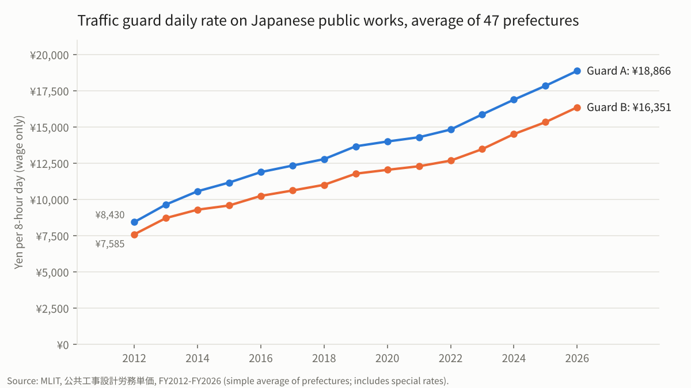
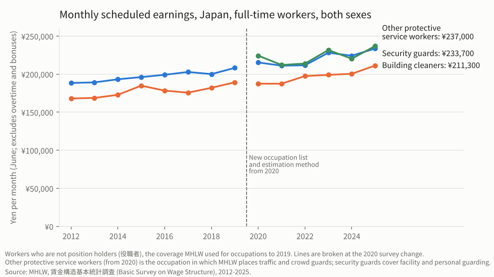
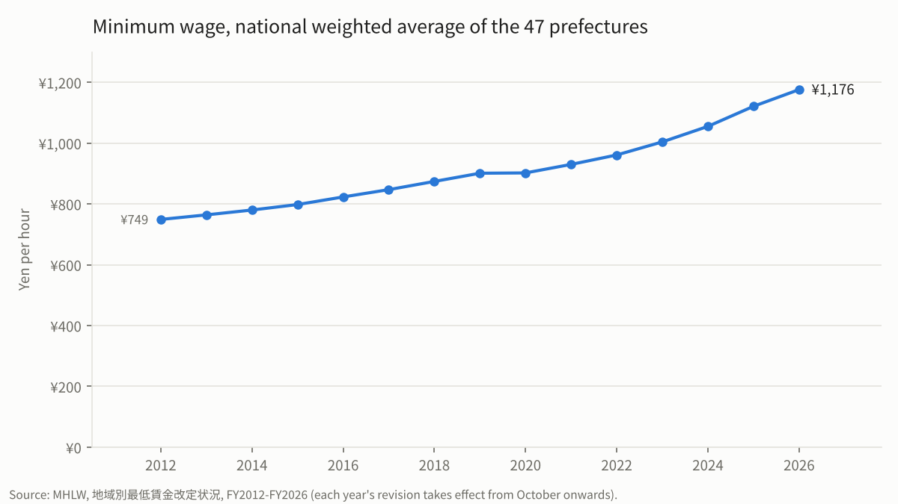
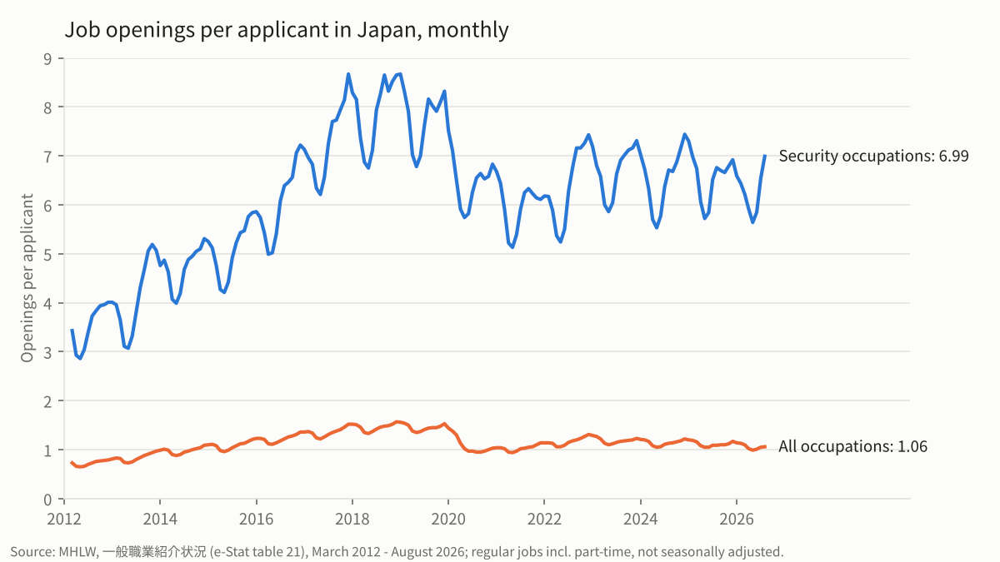

# japan-guard-price-panel

[](https://doi.org/10.5281/zenodo.23750536)

Published by [Mercenomics](https://mercenomics.org), an independent data archive on the business of force for hire.

Japan's official daily pay rates for traffic guards on public works, for all 47 prefectures, every year from FY2012 to FY2026; what security guards are actually paid in each prefecture, 2012-2025; each prefecture's minimum wage, FY2002-FY2026; and how many job openings there are for each security job seeker.

Every year Japan's Ministry of Land, Infrastructure, Transport and Tourism (MLIT) sets the *public works design labor rates* (公共工事設計労務単価): the daily wage that government cost estimates assume for each construction trade in each prefecture. Two of the trades are traffic guards working for private security companies:

- **Guard A** (交通誘導警備員A): a security company guard doing traffic guarding who has passed the national grade 1 or grade 2 traffic-guarding exam.
- **Guard B** (交通誘導警備員B): any other security company guard directing traffic.

This repo turns the ministry's yearly PDF tables into one clean table. It adds three series from the Ministry of Health, Labour and Welfare (MHLW): what security guards (and, for comparison, building cleaners) are paid in each prefecture, from the Basic Survey on Wage Structure; each prefecture's minimum wage; and monthly job-openings figures for security occupations.









**Status:** data built and checked.

## The data

### Guard rates: `data/clean/guard_rates_by_prefecture.csv`

 has 1,410 rows: 15 table years x 47 prefectures x 2 grades.

| Column | Meaning |
|---|---|
| `table_year` | The year the table is published for (FY2012-FY2026) |
| `effective_from` | Month the rates took effect (YYYY-MM) |
| `pref_code`, `prefecture_ja`, `prefecture_en` | Prefecture (standard codes 01-47) |
| `grade` | A or B |
| `daily_rate_yen` | Rate in yen for a regular 8-hour working day |
| `special_rate` | `yes` if the source marks the figure as a special rate (see below) |
| `note` | What the special rate is |
| `source_file`, `source_page` | Where the figure is in `data/raw/mlit/` |

### Pay: `data/clean/pay_by_prefecture.csv`

What full-time security guards are paid in each prefecture and in Japan as a whole, survey years 2012-2025, from MHLW's Basic Survey on Wage Structure (賃金構造基本統計調査), with two comparison occupations: building cleaners (ビル清掃員 to 2019, ビル・建物清掃員 from 2020) and, to 2019, gatekeepers (守衛, see below). 6,144 rows.

| Column | Meaning |
|---|---|
| `survey_year` | Survey year (pay for June of that year) |
| `classification` | MHLW's occupation list to 2019, or the list based on the Japan Standard Occupational Classification from 2020 |
| `position_holders` | `excluded`: workers who are not position holders (役職者); `included`: all workers (2020-2025 only) |
| `pref_code`, `prefecture_ja`, `prefecture_en` | Prefecture (standard codes 01-47; 00 = Japan) |
| `occupation`, `occupation_en`, `occupation_ja` | `security_guards`, `building_cleaners` or `gatekeepers` |
| `sex` | `total` (both sexes), `male` or `female` |
| `age`, `tenure_years` | Average age and years of service |
| `scheduled_hours`, `overtime_hours` | Hours worked in June: scheduled (所定内実労働時間数) and overtime (超過実労働時間数) |
| `contractual_earnings_kyen` | Cash earnings for June paid under the contract, including overtime pay (きまって支給する現金給与額), thousand yen |
| `scheduled_earnings_kyen` | The same without overtime and similar pay (所定内給与額), thousand yen, before tax |
| `annual_bonus_kyen` | Bonuses and other special earnings over the previous calendar year (年間賞与その他特別給与額), thousand yen |
| `workers_tens` | Estimated number of workers, in tens |
| `source_file`, `source_sheet`, `source_row` | Where the figures are in `data/raw/mhlw_wages/` |

### Minimum wages: `data/clean/minimum_wage_by_prefecture.csv`

Each prefecture's minimum wage (地域別最低賃金) in yen per hour, FY2002-FY2026, with the date each year's revision took effect, and the national weighted average. 1,200 rows.

| Column | Meaning |
|---|---|
| `fiscal_year` | Fiscal year of the revision |
| `pref_code`, `prefecture_ja`, `prefecture_en` | Prefecture (00 = national weighted average) |
| `hourly_yen` | Minimum wage, yen per hour |
| `effective_date` | Date the amount took effect (blank for the national average) |

### Job openings: `data/clean/security_jobs_monthly.csv`

Monthly national figures, March 2012 to August 2026, from MHLW's job placement statistics (一般職業紹介状況), for **security occupations** (保安の職業 / 保安職業従事者) and, as a benchmark, **all occupations**. Measures: new openings, active openings, new applicants, active applicants, and active openings per applicant (有効求人倍率). Regular jobs including part-time, not seasonally adjusted.

| Column | Meaning |
|---|---|
| `month` | YYYY-MM |
| `classification` | Occupation classification the figure is published under (see below) |
| `occupation`, `occupation_ja`, `occupation_en` | `security` or `all` |
| `measure` | `new_openings`, `active_openings`, `new_applicants`, `active_applicants`, `active_openings_ratio` |
| `value` | Number of people/openings, or the ratio |
| `source_file`, `source_sheet` | Where the figure is in `data/raw/mhlw/` |

- These figures count only jobs and job seekers registered at Hello Work, Japan's public employment offices, not the whole labor market.
- **Security occupations are broader than traffic guards.** MHLW does not publish a guard-only series in these tables, so this is the closest available measure.
- **Two classifications.** Up to March 2023 MHLW used its own occupation classification (4th revision); from April 2023 it uses the Japan Standard Occupational Classification, recalculated back to April 2022. For security occupations the two give identical figures in the 12 months they overlap (April 2022-March 2023), so the series can be joined; both versions are kept in the file.
- National only: these tables do not break occupations down by prefecture.

## What the guard rates are, and are not

- **They are wages, not prices.** MLIT states that the rates cover only the wage paid to the worker. They exclude the security company's overheads, employer social insurance, training and profit, so they are well below what a client pays a security company per guard-day.
- They are set from MLIT's yearly survey of wages actually paid on public works, and are used to estimate costs for public contracts.
- **Special rates.** In FY2012-FY2022, Iwate, Miyagi and Fukushima carry special rates (round brackets in the source) set to reflect failed tenders after the 2011 earthquake. In FY2021, five prefectures carry rates under a special COVID-19 measure (angle brackets). These are marked in `special_rate`.
- **FY2013 jump.** Almost every prefecture rises more than 15% between FY2012 and FY2013. This matches MLIT's own figure of a 15.1% rise across all trades that year; it is not a data error.
- FY2012 calls the two grades 交通誘導員A/B; from FY2014 they are called 交通誘導警備員A/B.
- Before FY2007 the two grades were not separated, so the panel starts at FY2012, the earliest year MLIT links online.

## What the pay figures are, and are not

- **Full-time workers only.** The figures are for general workers (一般労働者), that is, workers who are not short-time workers. Scheduled earnings are the pay for June under the employment contract, without overtime and similar pay, before tax; bonuses cover January-December of the previous year.
- **All security guards, not only traffic guards.** MHLW's occupation covers guards of every kind. From 2020 it also includes gatekeepers: MHLW's 2020 guide maps 守衛 (old number 602) and 警備員 (old number 601) to the new occupation 1453 警備員. To 2019 the two are separate rows here, so a series close to the new definition can be built by combining them, weighted by workers.
- **The survey changed in 2020.** In MHLW's words, from 2020 it covers all workers, including position holders, in 144 occupations consistent with the Japan Standard Occupational Classification; until 2019 it covered some workers, excluding position holders, in 129 occupations of its own. The way the sample is scaled up to the population also changed. Figures before and after 2020 are therefore not strictly comparable.
- **Position holders.** MHLW also publishes the 2020-2025 tables without position holders (役職者: department heads, section heads, supervisors and similar ranks), which matches the coverage of the years before 2020. Both versions are kept: use `position_holders = excluded` for a series that runs from 2012 to 2025.
- **A sample survey.** Prefecture figures for one occupation rest on a sample of establishments and workers, so small prefectures can move a lot from one year to the next (the checks list every change over 15%). Worker counts are estimates, published in tens.
- **Gaps.** MHLW leaves a cell blank ("-") when it publishes no figure; 39 rows here are blank, mostly women guards in small prefectures and gatekeepers.

## What the minimum wages are

- Each prefecture's minimum wage is revised once a fiscal year. The revision takes effect on the date in `effective_date`, which in recent years falls between October and the following March. Where a year's amount did not change, MHLW's file keeps the earlier date (FY2003 for 42 prefectures; FY2020 for seven).

## How it was checked

Guard rates: `code/02_check.py` writes `data/clean/checks_report.md`:

1. Every PDF was read twice with two different PDF engines (PyMuPDF and pdfplumber). All 1,410 values agree.
2. Every table year has all 47 prefectures and both grades.
3. All falls and rises above 15% were listed and looked at (only the FY2013 jump, explained above).
4. The simple average of the 47 prefectures was compared with MLIT's printed nationwide average where the release gives one.
5. A random sample of rows was checked by eye against images of the PDF pages (all match).

Job openings: `code/04_check_mhlw_jobs.py` writes `data/clean/checks_report_jobs.md`:

1. Every printed ratio equals active openings divided by active applicants (372 of 372).
2. MHLW's own yearly figures equal the average of the 12 monthly values extracted (224 of 224).
3. No months are missing.
4. The two classifications agree for security occupations in every overlapping month.

Pay: `code/07_check_mhlw_wages.py` writes `data/clean/checks_report_pay.md`:

1. Every survey year has Japan and all 47 prefectures for each occupation and coverage.
2. Every value was read a second time from the source file with a different Excel reader (python-calamine; the extraction uses xlrd and openpyxl): all 49,152 values agree.
3. Where MHLW publishes both sexes and each sex, total workers equal men plus women (1,507 of 1,507 region-years, within 20 people) and the total's earnings lie between men's and women's (1,507 of 1,507).
4. Japan's figures match the worker-weighted mean of the 47 prefectures (largest gap 0.18 thousand yen) and the sum of their workers.
5. Every year-on-year change over 15% is listed for inspection.
6. Every blank cell is listed.

Minimum wages: `code/09_check_minimum_wages.py` writes `data/clean/checks_report_minwage.md`:

1. Every fiscal year has all 47 prefectures and the national average.
2. No prefecture's minimum wage falls from one year to the next.
3. Each revision took effect within its fiscal year (or keeps the earlier date when the amount did not change).
4. The national weighted average lies between the lowest and highest prefecture.
5. The national averages for FY2024 (1,055 yen) and FY2025 (1,121 yen) match MHLW's press release.

## Reproduce

```
pip install -r requirements.txt
python code/01_extract_mlit_rates.py
python code/02_check.py
python code/03_extract_mhlw_jobs.py
python code/04_check_mhlw_jobs.py
python code/05_charts.py
python code/06_extract_mhlw_wages.py
python code/07_check_mhlw_wages.py
python code/08_extract_minimum_wages.py
python code/09_check_minimum_wages.py
python code/10_charts_pay.py
```

## Sources and license

- Data source: 「公共工事設計労務単価」（国土交通省）, https://www.mlit.go.jp/totikensangyo/const/1_6_bt_000217.html, used under the Public Data License 1.0. The clean table is edited from MLIT's files (「公共工事設計労務単価」（国土交通省）を加工して作成) and is not an official MLIT product. Details in [`data/README.md`](data/README.md).
- Data source: 「一般職業紹介状況（職業安定業務統計）」（厚生労働省）, via e-Stat, https://www.e-stat.go.jp/stat-search/files?toukei=00450222&tstat=000001020327, used under e-Stat's terms of use (compatible with CC BY 4.0). The clean table is edited from these files and is not an official MHLW product.
- Data source: 「賃金構造基本統計調査」（厚生労働省）, via e-Stat, https://www.e-stat.go.jp/stat-search/files?toukei=00450091&tstat=000001011429, used under e-Stat's terms of use (compatible with CC BY 4.0). The clean table is edited from these files and is not an official MHLW product.
- Data source: 「平成14年度から令和８年度までの地域別最低賃金改定状況」（厚生労働省）, https://www.mhlw.go.jp/stf/seisakunitsuite/bunya/koyou_roudou/roudoukijun/minimumichiran/, used under the Public Data License 1.0 (https://www.mhlw.go.jp/chosakuken/index.html). The clean table is edited from MHLW's file and is not an official MHLW product.
- Code: MIT (see `LICENSE`). The clean dataset: CC BY 4.0.

## Cite

Azom, Kazi Affnann (2026). *japan-guard-price-panel: Japan's public works pay rates for traffic guards, security guards' pay and minimum wages by prefecture, 2012-2026* (Version v1.1.0) [Data set]. Mercenomics. https://doi.org/10.5281/zenodo.23852300

- This version (v1.1.0): [10.5281/zenodo.23852300](https://doi.org/10.5281/zenodo.23852300)
- All versions (always points to the latest): [10.5281/zenodo.23750536](https://doi.org/10.5281/zenodo.23750536)
- Version v1.0.0 (guard rates and job openings only): [10.5281/zenodo.23750537](https://doi.org/10.5281/zenodo.23750537)

See also [`CITATION.cff`](CITATION.cff).
